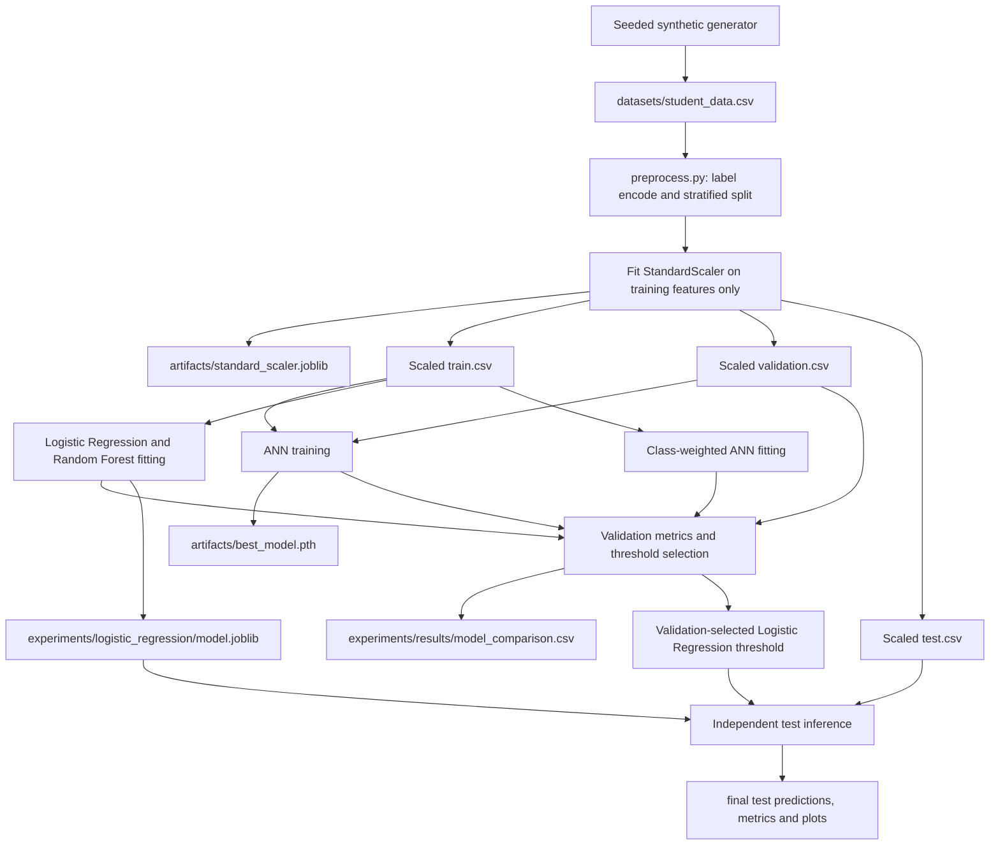

# System Architecture

## Overview

The project has two separate phases:

- **Offline preparation and experiments:** synthetic CSV generation, scaling,
  ANN training, scikit-learn model fitting, validation-based comparison, and
  one independent test evaluation.
- **Local inference:** Streamlit loads the already fitted Logistic Regression
  estimator and the scaler fitted on training features, validates user inputs,
  transforms them, and displays the predicted class and probabilities.

`main.py` is a data-only command-line entry point. Its explicit `inspect`
command loads and reports the source CSV; `prepare` loads and validates the CSV
before invoking preprocessing. Neither command trains a model or launches
Streamlit. Training, validation, testing, and deployment remain separate.

## Offline data/model flow



The threshold-selection routine compares validation thresholds by balanced
accuracy, then uses fail precision and proximity to 0.5 for ties. It does not
read test data. The final test script verifies the saved fit and threshold
provenance before opening the test split.

## Streamlit inference data flow

```mermaid
flowchart LR
    UI[Streamlit numeric inputs] --> V[Range validation]
    V --> DF[Ordered feature row]
    S[Saved StandardScaler] --> T[Transform with training-fitted scaling]
    DF --> T
    T --> LR[Saved Logistic Regression model]
    M[model.joblib] --> LR
    LR --> PROB[Pass and Fail probabilities]
    PROB --> TH{P(pass) >= 0.45458775758743286?}
    TH -->|Yes| PASS[Display Pass]
    TH -->|No| FAIL[Display Fail]
```

## Saved inference components

| Component | Current file | Role |
|---|---|---|
| Logistic Regression estimator | `experiments/logistic_regression/model.joblib` | Produces probabilities for encoded classes 0 and 1 |
| Preprocessing scaler | `artifacts/standard_scaler.joblib` | Training-fitted `StandardScaler` for the three input features |
| Feature order | `study_hours`, `attendance`, `previous_marks` | Must match scaler and estimator training order |
| Decision threshold | `0.45458775758743286` | Frozen on validation by maximum balanced accuracy |
| Streamlit entry point | `deployment/app.py` | Loads artifacts and performs inference only |

The scaler stores feature names and checks that its order matches the app.
The model is checked for three inputs and class order `[0, 1]`, where 0 is fail
and 1 is pass. The app restricts study hours to 0–10, attendance to 40–100, and
previous marks to 20–100, matching synthetic training ranges. It transforms
the ordered input row with the existing scaler before calling
`predict_proba`.

The model and scaler are cached as Streamlit resources; application startup
does not call a training method or modify either artifact. The interface
displays both class probabilities, the predicted outcome, and the frozen
threshold. It also warns that the data are synthetic and the probabilities
have not been established as calibrated real-world probabilities.

## Related scripts and outputs

- `datasets/generate_synthetic_data.py`, `datasets/load_dataset.py`
- `preprocessing/preprocess.py`
- `training/train.py`, `validation/validate.py`
- `experiments/compare_models.py`
- `testing/test.py`, `experiments/final_test_logistic_regression.py`
- `results/` and `experiments/results/` for saved histories, comparisons,
  predictions, metrics, and visualizations

`evaluation/evaluate.py` provides reusable binary metrics, and
`visualization/plots.py` provides reusable loss, confusion-matrix, and ROC
plots. Existing training, validation, testing, and experiment scripts retain
their saved-output workflows.
