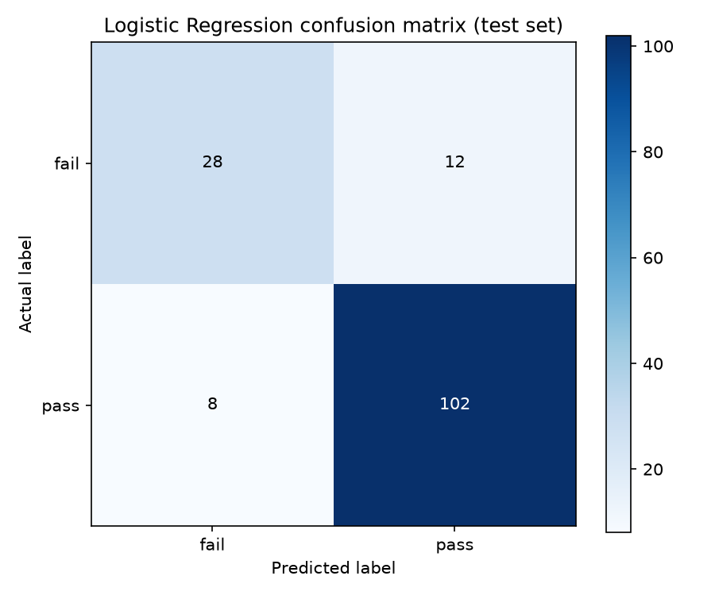
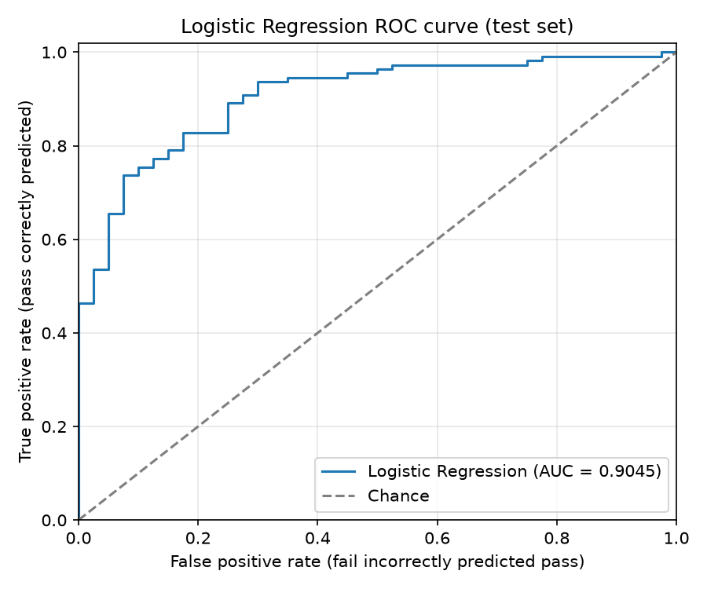

# Final Independent Evaluation Report

## Scope and verification

This report consolidates the existing saved evaluation outputs. No model was retrained, no inference was rerun, and no test-based threshold selection was performed. I read `final_test_metrics.csv`, `final_test_predictions.csv`, the original ANN `test_metrics.csv`, and inspected the saved Logistic Regression confusion matrix and ROC plot.

The final prediction CSV contains 150 rows. The exact Logistic Regression threshold recorded on every row is **0.45458775758743286**. It was selected from validation data by maximizing validation balanced accuracy; the test data was used only for independent evaluation.

The test split contains 40 fails and 110 passes.

## Logistic Regression results

| Metric | Test result |
|---|---:|
| Accuracy | 0.866667 |
| Fail precision | 0.777778 |
| Fail recall | 0.700000 |
| Fail F1-score | 0.736842 |
| Pass precision | 0.894737 |
| Pass recall | 0.927273 |
| Pass F1-score | 0.910714 |
| Macro precision | 0.836257 |
| Macro recall | 0.813636 |
| Macro F1-score | 0.823778 |
| Balanced accuracy | 0.813636 |
| ROC-AUC | 0.904545 |
| Classification threshold | **0.45458775758743286** |

### Confusion matrix

The stored matrix is arranged with rows = actual `[fail, pass]` and columns = predicted `[fail, pass]`:

```text
                 Predicted fail   Predicted pass
Actual fail             28               12
Actual pass               8              102
```

With the project encoding `pass = 1` and `fail = 0`, the conventional positive-class counts are:

- **TP (pass correctly predicted pass):** 102
- **TN (fail correctly predicted fail):** 28
- **FP (fail incorrectly predicted pass):** 12
- **FN (pass incorrectly predicted fail):** 8

If Fail is treated as the positive class instead, the equivalent counts are TP = 28, TN = 102, FP = 8, FN = 12. Fail recall is 28 / (28 + 12) = 0.700000; pass recall is 102 / (102 + 8) = 0.927273.

## Comparison with the original ANN

Both models were evaluated on the same 150-record test split. The original ANN used a **0.5 threshold**. Logistic Regression used its validation-selected threshold of **0.45458775758743286**.

| Metric | Original ANN | Logistic Regression |
|---|---:|---:|
| Threshold | 0.5 | 0.45458775758743286 |
| Accuracy | 0.733333 | 0.866667 |
| Fail recall | 0.000000 | 0.700000 |
| Pass recall | 1.000000 | 0.927273 |
| Balanced accuracy | 0.500000 | 0.813636 |
| ROC-AUC | 0.699773 | 0.904545 |
| Confusion matrix, rows/columns `[fail, pass]` | `[[0, 40], [0, 110]]` | `[[28, 12], [8, 102]]` |

The original ANN predicted every record as Pass. Its 0.733333 accuracy matches the test split's Pass proportion (110 / 150), while its Fail recall is zero. Logistic Regression correctly identified 28 of the 40 fails and 102 of the 110 passes. It made 12 fail-to-pass errors and 8 pass-to-fail errors.

This shows why accuracy alone is insufficient for an imbalanced classification task: a model can achieve the majority-class rate while missing every fail. Fail recall, pass recall, balanced accuracy, and the confusion matrix make the class-specific errors visible.

## Limitations

- The data and labels are synthetic. The results measure how these models reproduce the generated labeling rule, not real student outcomes.
- The held-out test split contains only 150 examples, including 40 fail cases, so individual errors materially affect the reported metrics.
- The classification threshold was selected on validation data. The test results are independent of threshold selection, but performance on one synthetic split does not establish generalization to other datasets or institutions.
- The model's score has not been shown to be calibrated as a real-world probability.

## Saved artifacts

- Metrics: `final_test_metrics.csv`
- Predictions and probabilities: `final_test_predictions.csv`
- Confusion matrix: `final_test_confusion_matrix.png`
- ROC curve: `final_test_roc_curve.png`




